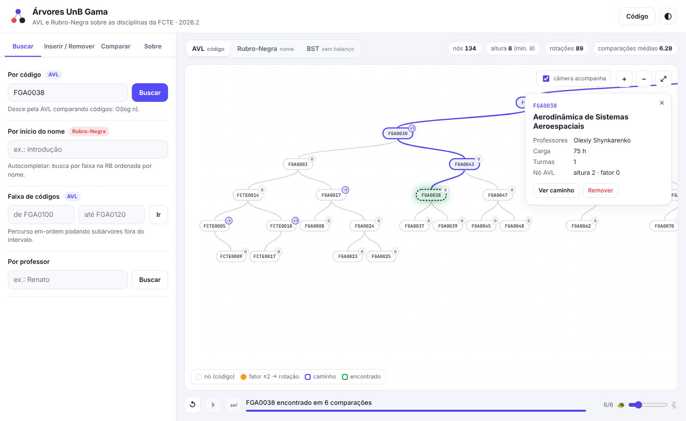
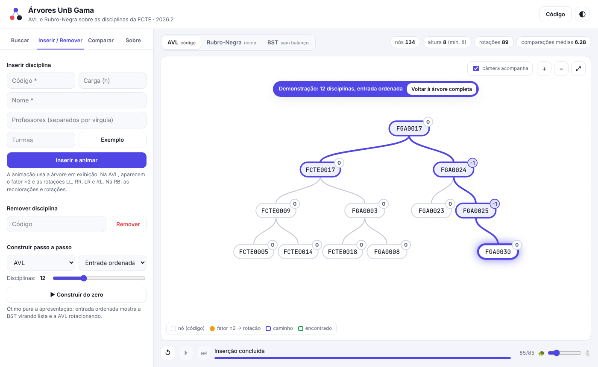
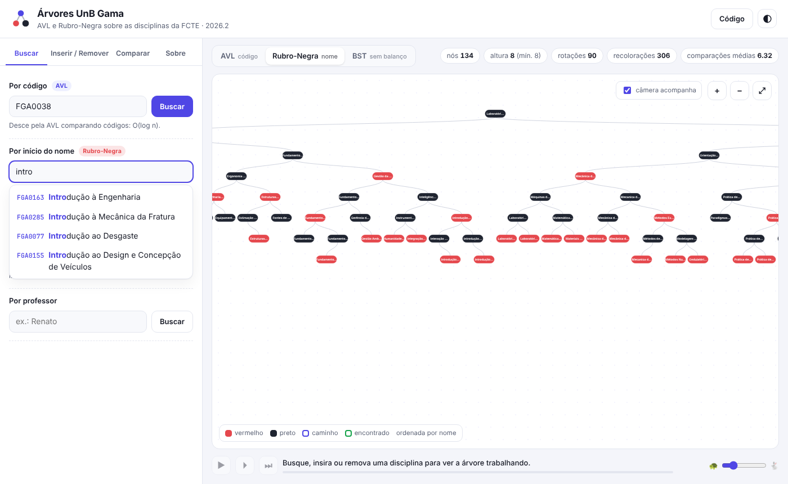
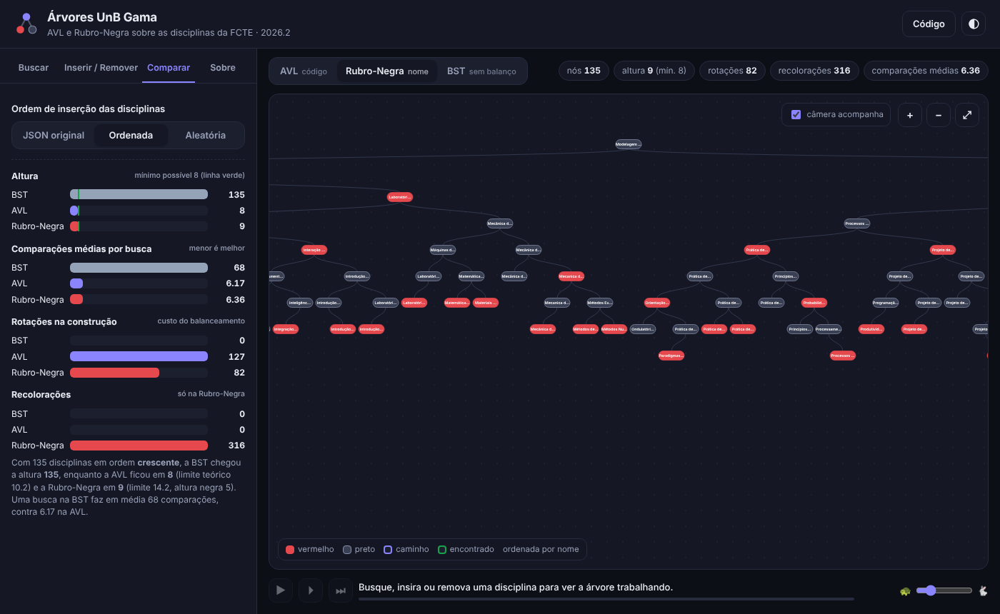

# G13_Arvores_EDA2-2026.2

## Árvores AVL e Rubro-Negra com as Matérias da UnB Gama

Projeto desenvolvido para a disciplina de **Estruturas de Dados e Algoritmos 2 (EDA2)**.

Este trabalho usa a mesma base dos trabalhos anteriores ([Busca](https://github.com/eda2-2026/G13_Busca_EDA2-2026.2) e [Ordenação](https://github.com/eda2-2026/G13_Ordenacao_EDA2-2026.2)). A diferença é que a lista ordenada com busca binária dá lugar a **árvores binárias de busca balanceadas**, implementadas do zero em Python. Há também uma **interface web** que anima cada passo do balanceamento.

**Acesse:** https://eda2-2026.github.io/G13_Arvores_EDA2-2026.2/

## Alunos

| Matrícula | Nome |
| --- | --- |
| 23/1030691 | Guilherme Ferreira Brandão |

## Sobre o projeto

A base possui **134 disciplinas do período 2026.2** da **FCTE (UnB Gama)**, obtidas na consulta pública de turmas do SIGAA. Os dados estão em `data/disciplinas.json`.

Cada disciplina é inserida em três árvores:

| Árvore | Chave | Para que serve |
| --- | --- | --- |
| **AVL** (`src/arvore_avl.py`) | código (`FGA0038`) | busca por código, faixa de códigos, listagem em ordem, inserção e remoção |
| **Rubro-Negra** (`src/arvore_rubro_negra.py`) | nome normalizado | busca pelo início do nome (autocompletar) e listagem alfabética |
| **BST simples** (`src/arvore_bst.py`) | código | comparação: mostra o que acontece **sem** balanceamento |

As três compartilham a mesma base (`ArvoreBST`): busca, descida para inserir, rotações e percursos. A AVL e a Rubro-Negra só acrescentam suas regras de balanceamento.

### Árvore AVL

Proposta por Adelson-Velsky e Landis (1962). Cada nó guarda sua altura, e o **fator de balanceamento** (`altura(esq) − altura(dir)`) precisa ficar em −1, 0 ou +1.

Depois de inserir ou remover, o algoritmo sobe pelo caminho até a raiz atualizando as alturas. Quando algum nó chega a ±2, aplica-se uma rotação:

- **LL**: rotação simples à direita;
- **RR**: rotação simples à esquerda;
- **LR**: rotação à esquerda no filho e depois à direita no nó;
- **RL**: rotação à direita no filho e depois à esquerda no nó.

A altura fica sempre abaixo de **1,44·log₂(n+2)**.

### Árvore Rubro-Negra

Cada nó é vermelho ou preto, com estas regras: a raiz é preta, um nó vermelho não tem filho vermelho e todo caminho até uma folha nula tem o mesmo número de nós pretos (a **altura negra**).

Na inserção, o novo nó entra vermelho e o conserto segue três casos: tio vermelho (só recolorir), triângulo (rotacionar o pai) e linha (rotacionar o avô e trocar as cores). A remoção trata o "preto extra" com os casos do irmão.

A altura fica abaixo de **2·log₂(n+1)**. São mais recolorações e menos rotações do que na AVL.

Como a chave é o nome, a busca por **prefixo** vira uma busca por faixa `[prefixo, prefixo + ￿)`. O percurso em-ordem só visita as subárvores que podem conter o intervalo.

### Complexidade

| Operação | BST simples (pior caso) | AVL | Rubro-Negra |
| --- | --- | --- | --- |
| Busca | O(n) | O(log n) | O(log n) |
| Inserção | O(n) | O(log n) | O(log n) |
| Remoção | O(n) | O(log n) | O(log n) |
| Faixa com k resultados | O(n) | O(log n + k) | O(log n + k) |
| Listar em ordem | O(n) | O(n) | O(n) |

### Resultados com as 134 disciplinas

| Ordem de inserção | Altura BST | Altura AVL | Altura RB | Comparações médias BST | AVL | RB |
| --- | --- | --- | --- | --- | --- | --- |
| Ordem do JSON | 18 | 8 | 8 | 9,23 | 6,28 | 6,32 |
| Ordenada por código | **134** | 8 | 9 | **67,5** | 6,16 | 6,35 |

Com a entrada ordenada, a BST simples vira uma lista encadeada. As árvores balanceadas continuam perto da altura mínima possível, que é 8.

## Interface web

A interface fica em `web/`. Ela usa HTML, CSS e JavaScript, com **D3.js** para desenhar a árvore. O código Python das árvores roda **dentro do navegador**, com o [Pyodide](https://pyodide.org). A lógica não foi reescrita em JavaScript: o front chama as funções de `src/api.py`.

- **Buscar:** por código (anima o caminho na AVL), pelo início do nome (autocompletar na Rubro-Negra), por faixa de códigos e por professor.
- **Inserir / Remover:** mostra cada passo. Na AVL aparecem o fator ±2 em destaque e as rotações. Na RB aparecem as recolorações e as rotações.
- **Construir passo a passo:** monta do zero uma árvore com 3 a 31 disciplinas, em ordem crescente, aleatória ou do JSON.
- **Comparar:** reconstrói as três árvores e compara altura, comparações médias, rotações e recolorações.
- Clique em um nó para ver a disciplina, a altura e o fator, ou a cor do nó.
- Tem tema claro e escuro, zoom e funciona no celular.









## Como executar

É necessário ter Python 3 instalado. O projeto usa apenas a biblioteca padrão.

### Interface web (local)

Na raiz do projeto, execute:

```bash
python -m http.server 8000
```

Depois, abra `http://localhost:8000/web/` no navegador. É preciso internet para carregar o Pyodide e o D3 pelas CDNs.

### Menu no terminal

```bash
python main.py
```

```text
1 - Buscar por codigo (AVL)
2 - Buscar por inicio do nome (Rubro-Negra)
3 - Buscar faixa de codigos (AVL)
4 - Buscar por professor
5 - Listar em ordem (percurso em-ordem)
6 - Inserir disciplina
7 - Remover disciplina
8 - Comparar arvores / reconstruir
9 - Desenhar arvore
0 - Sair
```

### Testes

```bash
python -m unittest discover tests -v
```

Os testes conferem as invariantes de cada árvore depois de inserir as 134 disciplinas em várias ordens, remover parte delas e inseri-las de novo. Na AVL, |fb| ≤ 1 e as alturas estão corretas. Na RB, a raiz é preta, não há vermelho seguido de vermelho e a altura negra é igual em todos os caminhos. Também conferem a ordem do percurso em-ordem, os ponteiros de pai, a busca, a faixa e o prefixo.

## Deploy

O workflow `.github/workflows/pages.yml` roda os testes e publica o site no **GitHub Pages** a cada push na branch `main`.

Para ativar, vá em *Settings → Pages → Build and deployment → Source: GitHub Actions*.

## Estrutura

```text
main.py                     menu no terminal
src/arvore_bst.py           BST base: busca, inserção, rotações, percursos
src/arvore_avl.py           AVL: alturas, fator de balanceamento, LL/RR/LR/RL
src/arvore_rubro_negra.py   Rubro-Negra: cores, inserção e remoção com correção
src/api.py                  fachada usada pelo terminal e pelo front (JSON)
src/carregaDados.py         leitura do JSON
src/normaliza.py            normalização de texto (acentos, maiúsculas)
web/                        interface (HTML, CSS, JS + D3 + Pyodide)
tests/test_arvores.py       testes das invariantes
data/disciplinas.json       134 disciplinas da FCTE 2026.2
```

## Fonte dos dados

Os dados foram retirados da página pública do SIGAA da Universidade de Brasília.


## Vídeo de apresentação

[*(link do vídeo)*](https://youtu.be/EGS2NUCP6gs)
